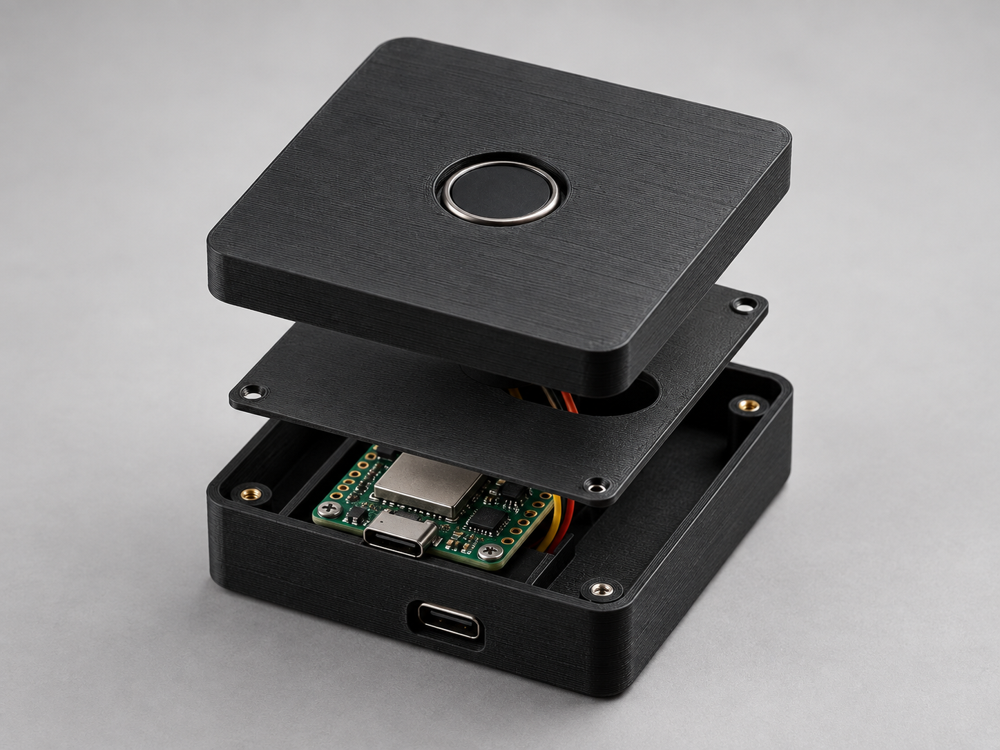

# Nicholas Birochi Portfolio

My personal portfolio at https://nicholasbirochi.com.br brings together selected projects, demonstrations and professional links. It is built with static HTML, CSS and JavaScript, with the published files in `dist/` and deployment through Cloudflare Pages.

## Content

Selected projects: CCB BI, Behavioral Analysis, JARVIS, Local AI + Automation, Petshop E-Commerce and Standalone Fingerprint Key. The CCB preview uses only aggregated period metrics, the Behavioral Analysis preview reproduces the real chart families with anonymous demonstration values, and JARVIS includes a short local-voice demonstration. The Petshop preview is rendered from the project's actual home-page design. Professional and learning timelines are based on Nicholas's supplied resume; private business documents and datasets are not published.

## Development

Open `index.html` in a browser, or serve the folder with `python -m http.server 8080` for HTTP checks. No package installation is required for local development.

For publication, run `python3 tools/build_site.py` in a clean checkout. The script copies only the explicit static publication files into `dist/`; it excludes documentation and local files. It refuses an existing destination to prevent deleting local content or publishing stale assets. Use `--output <new-directory>` for a separate preview. Build output is not versioned.

Cloudflare Pages must use **build command** `python3 tools/build_site.py` and **output directory** `dist`. Configure and verify that build before removing the currently tracked `dist/` files from the publication branch. The external Pages settings have not been verified by this change.

## Interaction and accessibility

- Portuguese/English/Spanish language combobox with local persistence and translated project dialogs.
- Project filters, project detail dialogs, JARVIS audio control, animated navigation and grouped contact links with hover previews and copy actions.
- Contact form submitted to Formspree over HTTPS, with accessible success and error feedback.
- Keyboard focus, Escape dismissal, reduced-motion support and local fonts.
- Responsive layouts for mobile, tablet and desktop.
- No analytics, authentication, external runtime scripts or cookies; only contact-form data is sent to Formspree when a visitor submits it.
- CSP and security headers in `_headers`; no secrets or client-side credentials.

## Assets

Barlow Condensed and Manrope are distributed with their OFL licenses. Icons are from Lucide (license in `assets/icons/license`). Project imagery is sourced from public project documentation, supplied assets or code-built previews. The Behavioral Analysis dashboard is a public-safe reproduction based on the project's real interface and graph types, while the local-AI diagram describes the documented n8n/Ollama workflow. The hero photograph uses Nicholas's provided LinkedIn portrait, edited for layout, with the original retained in the About section.

Timeline branding uses the Faculdade Engenheiro Salvador Arena logo supplied in Nicholas's local project files, the official Cambridge English candidate asset, Volkswagen's public logo asset and PratikaUD's public profile mark.

Hero image editing used the built-in image generation tool. Prompt: preserve the subject's exact identity, smile, hair and polo; replace the wall with flat charcoal #202221; compose a wide photograph with the subject on the right and empty background on the left, without text or props.

The active JARVIS frame was derived from the supplied interface screenshot with its central data sphere made legible for a video preview. The About photograph and professional portraits use the original files supplied by Nicholas. Featured recommendations use supplied or explicitly authorized draft text; profiles awaiting copy remain linked without invented testimonials.

Release marker: `2026-10-04-editorial-v29`.

## License

Original code and documentation are covered by [MIT](license). Photographs, personal records, logos and third-party assets are not relicensed by this notice.
